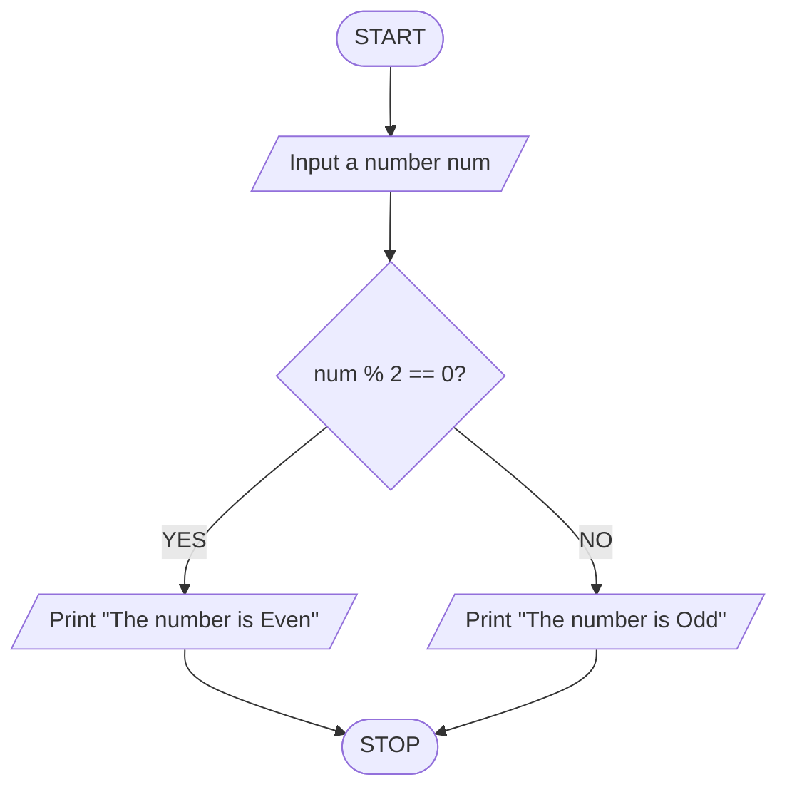

# Python Program to Check Even or Odd Number

## 1. Aim
To write a Python program to check whether a given number is even or odd.

## 2. Description
This program accepts a number from the user and checks whether it is even or odd using the modulus (%) operator.

- If the remainder is 0, the number is Even.
- Otherwise, the number is Odd.

## 3. Requirements
- Python 3.x
- VS Code / PyCharm / IDLE
- GitHub (optional)

## 4. Python Source Code

```python
num = int(input("Enter a number: "))

if num % 2 == 0:
    print("The number is Even")
else:
    print("The number is Odd")
```

## 5. Algorithm

1. Start the program.
2. Read a number from the user.
3. Check whether `num % 2 == 0`.
4. If the condition is true, print "The number is Even".
5. Otherwise, print "The number is Odd".
6. Stop the program.

## 6. Flowchart (Mermaid)



## 7. Flowchart Explanation

- **Oval:** Represents Start and Stop.
- **Parallelogram:** Represents Input and Output.
- **Diamond:** Represents the decision condition.
- **Arrow:** Represents the direction of execution.

## 8. Sample Output

### Example 1: Even Number

```text
Enter a number: 10
The number is Even
```

### Example 2: Odd Number

```text
Enter a number: 7
The number is Odd
```

## 9. How to Run the Program

1. Install Python 3.
2. Create a file named `even_odd.py`.
3. Copy and paste the source code.
4. Run the program.
5. Enter a number to check the result.

## 10. Conclusion

The program successfully checks whether a given number is even or odd using the modulus operator and if-else statements in Python.